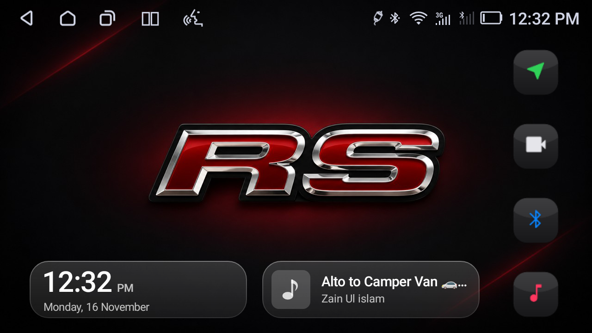
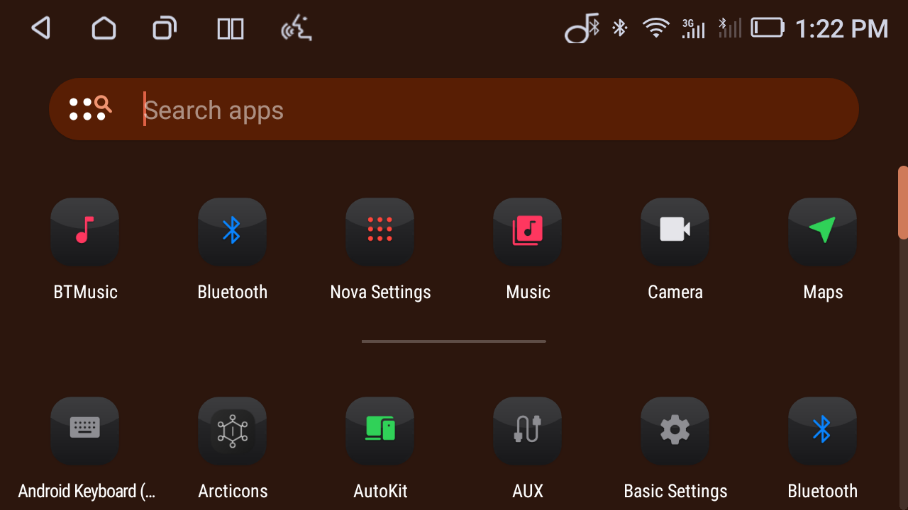

# clean-your-headunit

Clean your car's head unit with a modern UI and Apple-like widgets. Debloat and restyle an aftermarket Android car head unit over ADB, without root and without uninstalling
anything. Worked out on a **2023 Honda Civic RS Turbo** fitted with a **BWIC "Yato1 B100"** head unit
(Autochips AC8257, Android 9, firmware `OS_Yato1_B100_01_V2.00.23`).

It contains the findings, the debloat list, the small apps built along the way, and an agent skill
(`clean-your-headunit/`) that repeats the process on another unit.

CarPlay and the steering-wheel voice button are in a second repo:
[headunit-carplay-with-shortcuts](https://github.com/ahmadbilaldev/headunit-carplay-with-shortcuts).

| Home screen | App drawer |
|---|---|
|  |  |

## What was done

| Area | Result |
|---|---|
| Debloat | 15 packages disabled in three batches with `pm disable-user`, checked after a real reboot |
| Launcher | Nova Launcher as Home, vendor launcher left enabled as the fallback |
| Icons | Own dark icon pack, 34 icons drawn from Material Symbols, one accent colour per app |
| Widgets | Translucent "glass" Clock and Now Playing cards, plus older pill-style clock and RAM widgets |
| Navi button | Repointed from the dead Chinese maps app to Google Maps with two settings |
| Annoyances | USB camera prompt silenced, Play Store auto-update off so disabled apps stay disabled |
| Not possible | Boot logo (needs a flash), Play Protect certification (uncertified firmware) |

## The unit

| Fact | Value |
|---|---|
| Board | BWIC Yato1 B100, Autochips / MediaTek AC8257, arm64, 1.8 GB RAM |
| Android | 9 (API 28), `userdebug`, `test-keys`, `ro.debuggable=1` |
| Screen | 1280x720 at density 320, so 640x360 dp, landscape only |
| ADB | Over Wi-Fi on TCP 5555, with the laptop on the same network as the car |
| Power | Key-off is a sleep, not a shutdown. `adb reboot` is the only real reboot |
| Logging | Firmware drops everything below error level, so log with `Log.e` when debugging your own apps |

> **Good practice.** Do this work on your own home Wi-Fi, and switch network debugging off in Developer
> options when you are finished if your unit offers that setting.

## Debloat

The list is [`lists/bwic-yato1-b100-debloat.txt`](lists/bwic-yato1-b100-debloat.txt). Undo with
`lists/restore.sh <unit ip>`.

**Never disable these.** They run the radio, amplifier, steering-wheel keys, reverse camera and power:

| Package | Why |
|---|---|
| `com.bw.car`, `com.bw.carsetting`, `com.bw.source`, `com.bw.settings` | Car service, source switching, vendor settings |
| `com.bw.mediaplayer`, `com.bw.phone`, `com.bw.ipod` | Radio, media, Bluetooth phone |
| `com.bw.adas` | Reverse, cabin and front cameras |
| `com.bw.asr` | Receives the steering-wheel voice key |
| `com.bw.personalization`, `com.bw.userguide` | Navi-button target, vendor screens |
| `com.autochips.*` | Car events, quick boot, CarPlay service |
| `mdm.tw.com.mdm`, `com.example` | Persistent vendor services |
| Phone-link apps you use | Here: EasyConnection (`net.easyconn`), AutoKit (`cn.manstep.phonemirrorBox`) |

What went, and what it cost:

| Batch | Packages | Effect |
|---|---|---|
| 1 | AccuWeather, ES File Explorer, Skype, TuneIn, Gmail, Calendar | None |
| 2 | Google admin panel, Pinyin keyboard, feedback, partner setup, MediaTek call recorder | None |
| 3 | TXZ voice assistant, its adapter, Baidu location | Voice button does nothing until remapped (see the other repo) |

Things learned the hard way:

- **Play Store re-enables disabled apps.** After signing in, Gmail and Calendar came back as "updates".
  Set Play Store > Settings > Network preferences > Auto-update apps > Don't auto-update.
- **The device is not Play Protect certified**, so some Play installs are refused. F-Droid and direct
  downloads with a checked signature work.
- **Play Protect blocks sideloads that target an old Android version.** The dialog appears on the unit
  and times out in about two minutes: someone has to tap More details > Install anyway.
- **Navi button.** `settings put secure navigation_component_bw <component>` and
  `settings put global bw_navi_app_name <label>` point it at any app.

## Launcher and look

Nova Launcher 8 as Home, with the vendor launcher kept enabled. Settings that mattered on a 720p
landscape screen:

| Setting | Value | Why |
|---|---|---|
| Desktop grid | 4 x 4, padding None | Cell is about 251x157 px |
| Dock | Side dock, 3 pages | Nova has no bottom dock in landscape |
| Drawer grid | 6 columns x 2 rows | 4x4 at 120% icon size clipped labels and overlapped rows |
| Look & feel > Disable animations | On | The unit is slow; animations only add lag |
| Icon theme | Car Dark Icons | See below |

### Apps in `apps/`

All are plain Java, built with `aapt2`, `javac`, `d8`, `zipalign` and `apksigner`. No Gradle, no
network permission, no prebuilt binaries.

| Folder | What it is |
|---|---|
| `iconpack/` | Car Dark Icons. `gen_icons.py` draws a squircle plate and a tinted Material Symbols glyph per app, and writes the `appfilter.xml` Nova reads |
| `glass-widgets/` | Glass Clock and Glass Now Playing. Drawn as bitmaps at the size the launcher reports. Now Playing follows the active media session, here the Bluetooth one |
| `pills-widget/` | Earlier pill-shaped clock and RAM widgets in Russo One |
| `usb-sink/` | Claims the built-in USB camera's attach event so the unit stops asking which app should open it |
| `photo-launcher/` | A home-screen icon for the hidden stock camera app |

Build one with `apps/<name>/build.sh <out-dir>`. Signing uses `$KS` and `$KS_PASS`, defaulting to the
Android debug keystore. The icon pack also needs the Material Symbols Rounded variable font and its
`.codepoints` file from `google/material-design-icons`, and Python with Pillow.

Notes for anyone building widgets for a head unit:

- **Fonts do not survive `RemoteViews`.** A custom font set in a widget layout falls back to the
  system font inside the launcher. Draw text into a bitmap instead.
- **Now Playing needs notification-listener access** to read media sessions. Grant it with
  `cmd notification allow_listener <component>`.
- **Widget size in landscape** is `OPTION_APPWIDGET_MAX_WIDTH` by `OPTION_APPWIDGET_MIN_HEIGHT`.
- **JDK 21 and build-tools 34.** `d8` crashes on inner classes and lambdas compiled by JDK 21
  (`String.length() ... null`). Use static nested classes with an explicit outer reference.

## Driving the unit's screen from a laptop

Useful when nobody is in the car, and fiddly:

- `uiautomator dump` plus a small parser gives tappable coordinates by label.
- Nova's settings list renders blank at density 320. Run `wm density 200` first and reset it after.
- Nova's drawer opens the keyboard, which eats taps. Type in the drawer search, press Back, then
  `input draganddrop` the result onto the home screen.
- Long-pressing empty desktop opened Nova Search here, so widgets were added with
  `AppWidgetManager.requestPinAppWidget`. Nova put them on a screen that did not exist until it was
  restarted (`am force-stop`), then they appeared at 4x2 and were resized with the handles.

## Use the skill

```bash
git clone https://github.com/ahmadbilaldev/clean-your-headunit-skill
cp -r clean-your-headunit-skill/clean-your-headunit ~/.claude/skills/
```

Then ask Claude Code to "clean up my car head unit" with the laptop on the same Wi-Fi as the car.

## Related

- [headunit-carplay-with-shortcuts](https://github.com/ahmadbilaldev/headunit-carplay-with-shortcuts): native wired CarPlay and steering-wheel shortcuts on the same unit
- [clean-your-android-skill](https://github.com/ahmadbilaldev/clean-your-android-skill): the phone and TV version of this
- [cleanyourtv](https://github.com/Gathin23/cleanyourtv): the project whose disable-only rules this follows

MIT licence. Russo One (in `apps/pills-widget`) is under the SIL Open Font Licence.
